# Mise en place du SSO (SAML et OIDC) avec Microsoft Entra ID

## 1. Contexte et problématique

Une entreprise de 60 utilisateurs souhaite déployer plusieurs applications et permettre à ses collaborateurs d'y accéder. Cependant, l'entreprise prévoit de s'agrandir et donc d'accueillir de nouveaux utilisateurs.

Une problématique se pose alors :

- L'équipe IT de Gift va-t-elle devoir gérer une authentification différente pour chaque application ?

La réponse à cette question est **non**.

L'équipe IT ne souhaite pas que les utilisateurs aient à saisir des identifiants différents pour chaque application. Cela compliquerait la gestion des accès et l'expérience utilisateur.

Pour résoudre ce problème, l'entreprise va mettre en place une solution d'authentification unique (**Single Sign-On**).

Grâce au SSO, les utilisateurs peuvent accéder à plusieurs applications avec un seul compte et une seule authentification, sans avoir à saisir leurs identifiants à chaque fois qu'ils changent d'application.

---

## 2. Principes du SSO

### 2.1 Définition

L'authentification unique (SSO) est un mécanisme qui permet à un utilisateur de s'authentifier une seule fois afin d'accéder à plusieurs applications ou services auxquels il est autorisé à accéder, sans avoir à saisir à nouveau ses identifiants pour chaque application.

Ce mécanisme repose sur une relation de confiance entre un fournisseur d'identité (Identity Provider - IdP) et un ou plusieurs fournisseurs de services (Service Provider - SP).

Le fournisseur d'identité est chargé d'authentifier l'utilisateur, tandis que le fournisseur de services correspond à l'application à laquelle l'utilisateur souhaite accéder. L'IdP transmet au SP une preuve de l'authentification de l'utilisateur.

Ce mécanisme est mis en place grâce à des protocoles. Il en existe plusieurs, mais les plus utilisés sont SAML et OIDC.

### 2.2 SSO via le protocole SAML

#### Étape 1 : Accès à l'application

L'utilisateur se connecte à sa session de travail, puis souhaite accéder à une application (par exemple : Nextcloud) pour commencer ses tâches de la journée.

#### Étape 2 : Redirection vers le fournisseur d'identité

Il clique sur le bouton « Connexion via SSO ». Son navigateur le redirige alors vers le fournisseur d'identité (par exemple : Microsoft Entra ID), auprès duquel il s'authentifie afin de confirmer son identité. Cette redirection transporte une requête d'authentification SAML (`AuthnRequest`) émise par l'application.

#### Étape 3 : Vérification de l'identité et des accès

Microsoft Entra ID vérifie l'identité de l'utilisateur et contrôle si celui-ci est autorisé à accéder à l'application.

#### Étape 4 : Génération et transmission de l'assertion SAML

Si l'authentification et les conditions d'accès sont validées, Microsoft Entra ID génère une assertion SAML (un document au format XML) et la transmet au fournisseur de services (l'application) via le navigateur de l'utilisateur : Entra ID renvoie un formulaire HTTP POST vers l'URL ACS (Assertion Consumer Service) de l'application. Contrairement à OIDC, où l'échange des jetons se fait de serveur à serveur, l'assertion SAML transite donc par le navigateur.

Cette assertion peut contenir plusieurs types d'informations :

- **L'assertion d'authentification (Authentication Statement)** : elle confirme que l'utilisateur a été authentifié. Elle contient notamment l'heure de l'authentification et le type de méthode utilisée (mot de passe, authentification multifacteur, etc.).

- **L'assertion d'attributs (Attribute Statement)** : elle transmet des informations concernant l'utilisateur, telles que son nom, son adresse e-mail, son identifiant ou encore ses groupes d'appartenance.

- **L'assertion de décision d'autorisation (Authorization Decision Statement)** : elle indique si une action ou un accès à une ressource est autorisé ou refusé. Ce type d'assertion est facultatif et rarement utilisé dans les implémentations SAML classiques.

#### Étape 5 : Vérification de l'assertion par l'application

Le fournisseur de services (l'application) reçoit et vérifie la validité de l'assertion SAML, notamment sa signature numérique, son émetteur, sa période de validité et son destinataire.

#### Étape 6 : Accès accordé

Si toutes les vérifications sont conformes, l'application autorise l'utilisateur à accéder au service sans qu'il ait besoin de saisir à nouveau ses identifiants.

### 2.3 SSO via le protocole OIDC

Tout d'abord, OIDC (OpenID Connect) est un protocole d'authentification construit au-dessus d'OAuth 2.0.

OAuth 2.0 est un framework d'autorisation qui permet à une application d'obtenir un accès à des ressources. OIDC ajoute une couche d'authentification permettant de vérifier l'identité de l'utilisateur grâce à un ID Token.

Imaginons qu'un utilisateur soit connecté à sa session de travail et souhaite accéder à Grafana. Il clique sur le bouton « Connexion via SSO ».

#### Étape 1 : Redirection vers le fournisseur d'identité

Grafana (client OIDC) redirige le navigateur de l'utilisateur vers Microsoft Entra ID afin de démarrer le processus d'authentification.

Le navigateur envoie une requête HTTP GET vers le point de terminaison `/authorize` d'Entra ID.

Cette requête contient notamment les paramètres suivants :

```http
GET /oauth2/v2.0/authorize

client_id                  → Identifiant de l'application (Grafana-OIDC)
response_type=code         → Demande d'un code d'autorisation
scope=openid profile email offline_access
                           → Informations et autorisations demandées
redirect_uri               → Adresse de retour vers Grafana
state                      → Valeur aléatoire pour se protéger contre les attaques CSRF
nonce                      → Valeur aléatoire permettant de sécuriser l'ID Token
code_challenge             → Empreinte SHA-256 du code_verifier
code_challenge_method=S256 → Méthode utilisée pour générer l'empreinte PKCE
```

#### Étape 2 : Authentification de l'utilisateur

L'utilisateur est redirigé vers Microsoft Entra ID afin de confirmer son identité.

Entra ID vérifie l'identité de l'utilisateur, ses conditions d'accès et, si nécessaire, son affectation à l'application Grafana.

Si l'authentification est validée, Entra ID génère un code d'autorisation.

#### Étape 3 : Retour vers Grafana avec le code d'autorisation

Entra ID redirige le navigateur vers l'URL de retour de Grafana (`redirect_uri`) avec les paramètres suivants :

```http
?code=...            → Code d'autorisation à usage unique
&state=...           → Valeur state initialement envoyée par Grafana
&session_state=...   → Identifiant de session Entra ID (si fourni)
```

Grafana compare la valeur `state` reçue avec celle qu'il avait initialement générée.

Si les deux valeurs correspondent, le processus continue. Dans le cas contraire, Grafana rejette la réponse.

#### Étape 4 : Échange du code d'autorisation contre des jetons

Grafana effectue ensuite un appel directement auprès de Microsoft Entra ID (communication de serveur à serveur), vers le point de terminaison `/token`.

Il transmet les éléments suivants :

```http
POST /oauth2/v2.0/token

grant_type=authorization_code
code             → Code d'autorisation reçu à l'étape précédente
code_verifier    → Valeur originale générée par Grafana pour PKCE
client_id        → Identifiant de l'application Grafana
client_secret    → Secret de l'application (si requis)
redirect_uri     → Même URL de retour que lors de la première requête
```

Entra ID vérifie la validité du code d'autorisation, le `code_verifier`, l'identité de l'application et les autres paramètres de la requête.

#### Étape 5 : Réception des jetons

Si toutes les vérifications sont conformes, Entra ID renvoie une réponse contenant notamment :

- **ID Token** : jeton contenant les informations permettant à Grafana de connaître et de vérifier l'identité de l'utilisateur (claims).
- **Access Token** : jeton permettant d'accéder aux ressources protégées autorisées.
- **Refresh Token** : jeton permettant d'obtenir de nouveaux jetons sans demander systématiquement à l'utilisateur de se réauthentifier. Il n'est fourni que si le scope `offline_access` a été demandé (c'est le cas dans l'exemple de requête ci-dessus ; dans la configuration Grafana de ce lab, seuls `openid email profile` sont demandés, donc aucun refresh token n'est émis).

#### Étape 6 : Validation et création de la session

Grafana valide l'ID Token, notamment sa signature numérique, son émetteur (`iss`), son destinataire (`aud`), sa date d'expiration (`exp`) et le `nonce` lorsqu'il est utilisé.

Il récupère ensuite les informations de l'utilisateur à partir des claims présents dans le jeton.

Enfin, Grafana crée une session utilisateur, applique les rôles et permissions correspondant à sa configuration, puis redirige l'utilisateur vers sa page d'accueil.

---

## 3. Mise en application

### 3.1 Objectif

Gift.sa souhaite donner accès aux applications Grafana et BookStack. Comme nous pouvons le voir dans les images suivantes, aucun bouton SSO n'est disponible.

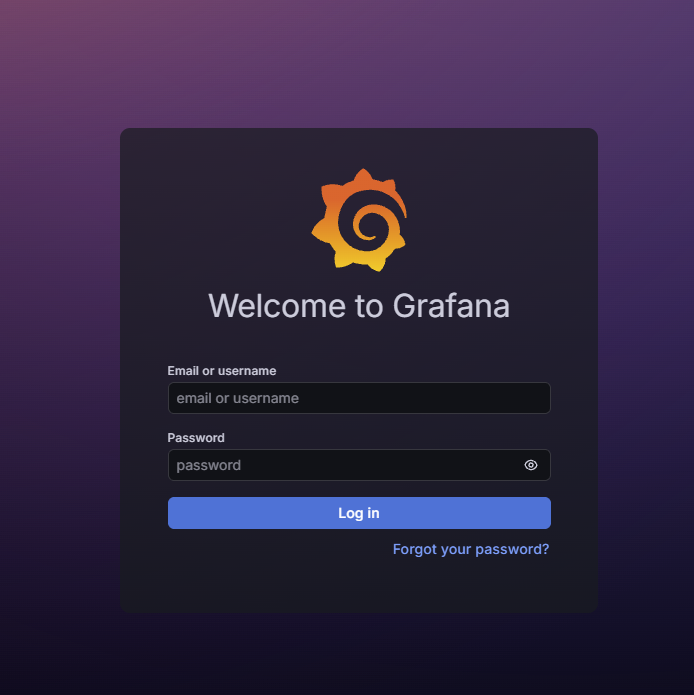

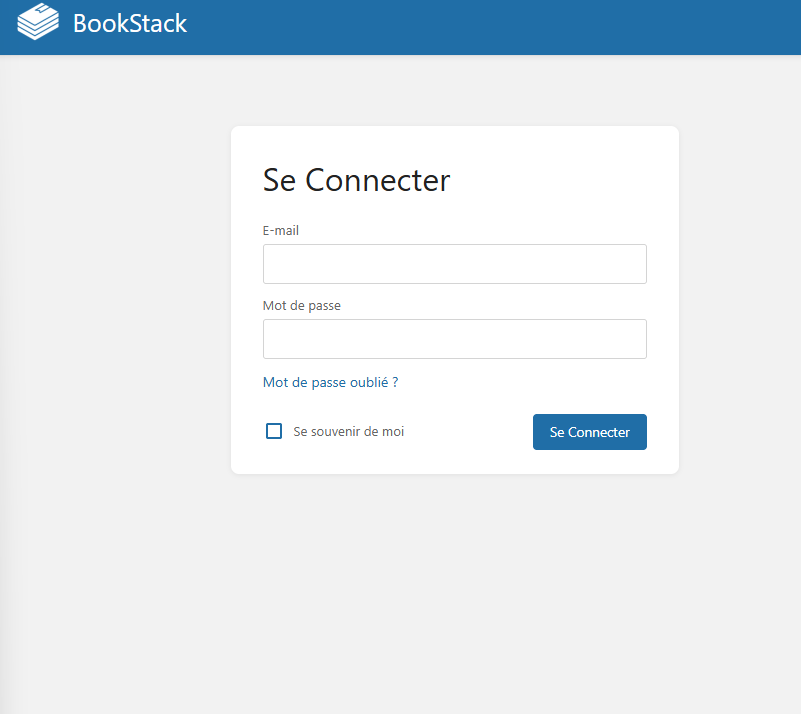

### 3.2 Grafana : SSO via OIDC

Sur une machine Linux, j'ai hébergé Grafana et configuré VirtualBox afin que cette application soit consultable depuis mon navigateur à l'adresse : <http://localhost:3000>

#### Inscrire l'application dans Entra ID

Dans Entra ID : **Inscriptions d'applications → Nouvelle inscription**.

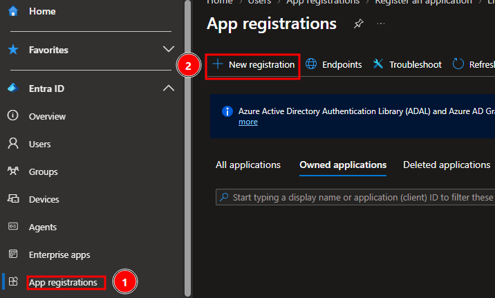

Ensuite, dans **Authentication (preview)**, il faut renseigner deux URI de redirection, comme indiqué dans la documentation de Grafana :

- `http://localhost:3000/login/azuread`
- `http://localhost:3000`


#### Créer le secret client

Aller dans **Certificats et secrets → Nouveau secret client**, puis copier tout de suite la **Valeur** (et non l'ID du secret).

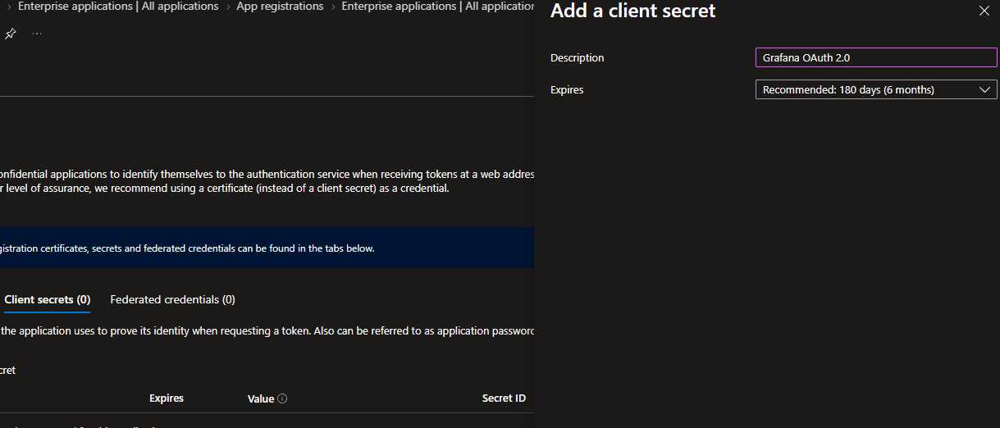

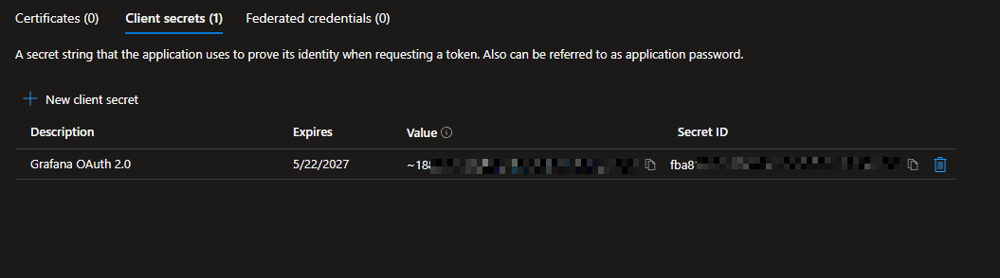

#### Configurer Grafana

Dans Grafana : **Administration → Authentification → Entra ID OAuth**.

| Champ | Valeur |
|---|---|
| Client ID | L'ID d'application |
| Client secret | La valeur du secret |
| Scopes | `openid email profile` |
| Auth URL | `https://login.microsoftonline.com/<TENANT_ID>/oauth2/v2.0/authorize` |
| Token URL | `https://login.microsoftonline.com/<TENANT_ID>/oauth2/v2.0/token` |
| Client authentication | `client_secret_post` |

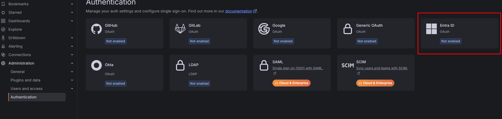

#### Affecter un utilisateur

Avant de tester avec Entra ID, il faut affecter un utilisateur à l'application. Dans mon cas, il s'agit de l'utilisateur `a.faure@gift.sa`.

> **Attention** : cette affectation ne restreint l'accès que si l'option « Affectation requise ? » est activée dans les propriétés de l'application d'entreprise. Sinon, tous les utilisateurs du tenant peuvent s'y connecter.

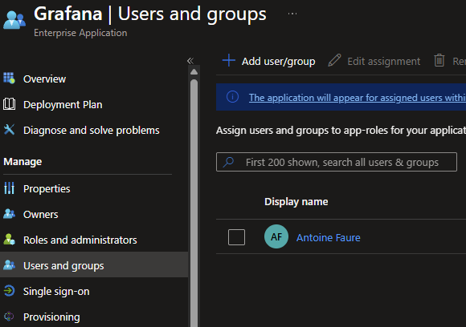

#### Tester la connexion

Tout est prêt, on peut essayer de se connecter avec Antoine Faure. En visitant <http://localhost:3000>, on voit le bouton « Connexion avec Microsoft Entra ID ».

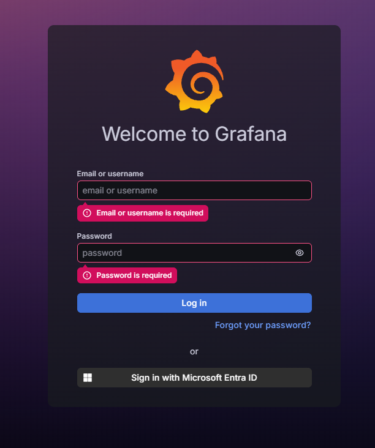

On clique sur ce bouton et le navigateur me redirige vers le portail de connexion d'Entra.

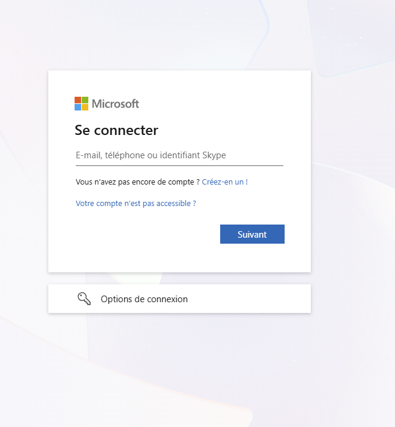

Une fois connecté, un message nous demande d'accepter les autorisations.

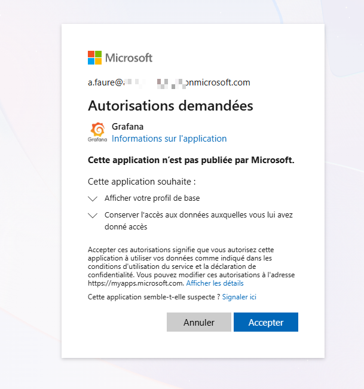

Une fois les autorisations acceptées, Antoine Faure a désormais accès à Grafana. Dans cette configuration, aucun mappage de rôles n'est défini : l'utilisateur reçoit le rôle par défaut de Grafana (Viewer). Il est possible d'attribuer les rôles Grafana à partir des rôles d'application ou des groupes Entra ID.

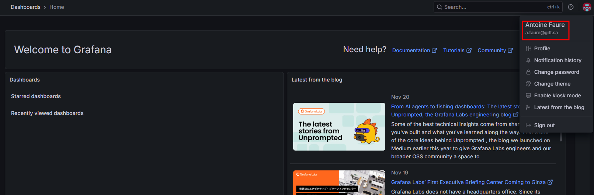

### 3.3 BookStack : SSO via SAML

Sur ma machine Linux, j'ai hébergé une seconde application, BookStack, avec le même réglage afin qu'elle soit accessible depuis mon navigateur à l'adresse : <https://localhost:9443>

#### Créer l'application dans Entra

1. Aller dans **Entra → Applications d'entreprise → Nouvelle application → Créer votre propre application → Intégrer toute autre application non-galerie**.
2. Ouvrir **Authentification unique → SAML**.
3. Dans **Configuration SAML de base**, renseigner :
   - **Identificateur** : `https://localhost:9443/saml2/metadata`
   - **URL de réponse** : `https://localhost:9443/saml2/acs`
   - **Sign-on URL** (optionnel) : `https://localhost:9443`

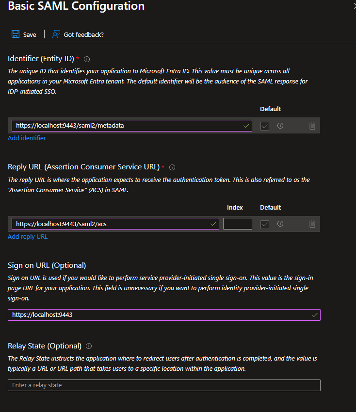

4. Dans **Attributs et revendications**, vérifier que les claims `emailaddress`, `name` et `givenname` sont bien envoyés.

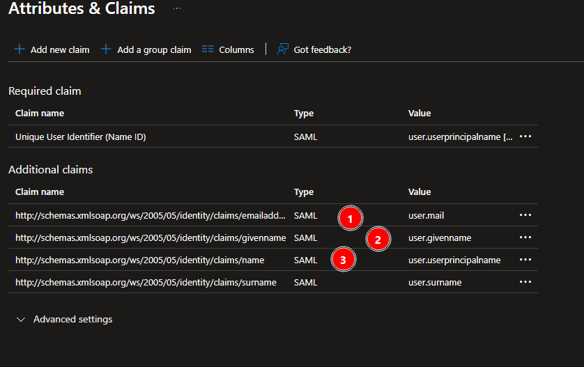

#### Récupérer les informations de l'IdP dans Entra

- **Tenant ID** : dans la section « Configurer *\<app\>* » de la page SSO.
- **Certificat** : télécharger le XML de métadonnées de fédération et copier le contenu de `X509Certificate`.

#### Configurer le fichier `.env` de BookStack

Sur ma machine Linux, j'ai renseigné les informations suivantes dans le fichier `.env` de l'application :

```ini
AUTH_METHOD=saml2
AUTH_AUTO_INITIATE=false
SAML2_NAME=SSO
SAML2_EMAIL_ATTRIBUTE=http://schemas.xmlsoap.org/ws/2005/05/identity/claims/emailaddress
SAML2_EXTERNAL_ID_ATTRIBUTE=http://schemas.xmlsoap.org/ws/2005/05/identity/claims/name
SAML2_DISPLAY_NAME_ATTRIBUTES=http://schemas.xmlsoap.org/ws/2005/05/identity/claims/givenname

SAML2_IDP_ENTITYID=https://sts.windows.net/<tenant-id>/
SAML2_AUTOLOAD_METADATA=false
SAML2_IDP_SSO=https://login.microsoftonline.com/<tenant-id>/saml2
SAML2_IDP_SLO=https://login.microsoftonline.com/<tenant-id>/saml2
SAML2_IDP_x509=<certificat sur UNE seule ligne, sans BEGIN/END>
SAML2_IDP_AUTHNCONTEXT=false
```

#### Affecter un utilisateur

Il reste juste à affecter un utilisateur pour pouvoir tester. J'ai affecté le même utilisateur que pour Grafana.

#### Tester la connexion

En visitant le lien <https://localhost:9443> et en cliquant sur le bouton « SSO », le navigateur me redirige vers le portail de connexion d'Entra ID.

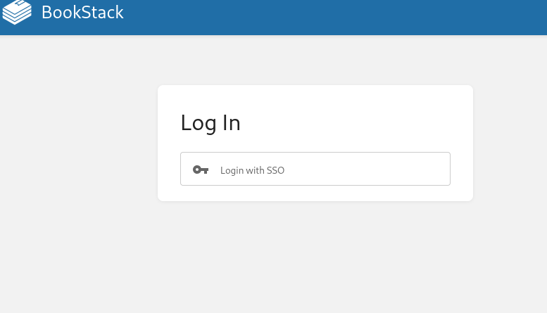

Une fois authentifié avec le compte d'Antoine Faure sur Entra, l'utilisateur peut accéder à BookStack.

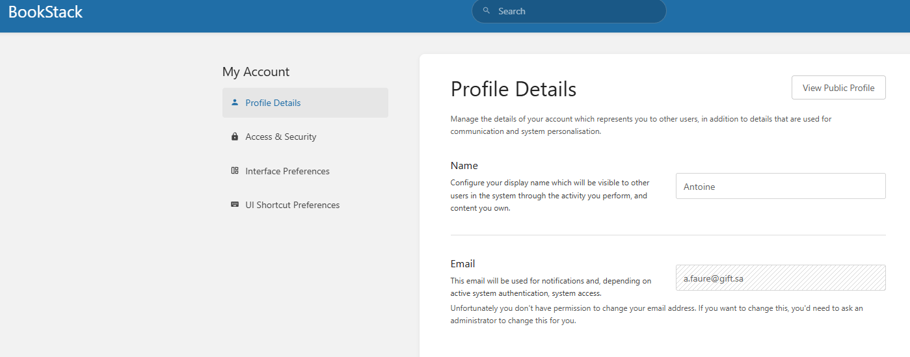

---

## 4. Troubleshooting

### 4.1 BookStack : erreur `AADSTS75011`

Lors du premier test de connexion à l'application BookStack en SSO, j'ai rencontré l'erreur suivante :

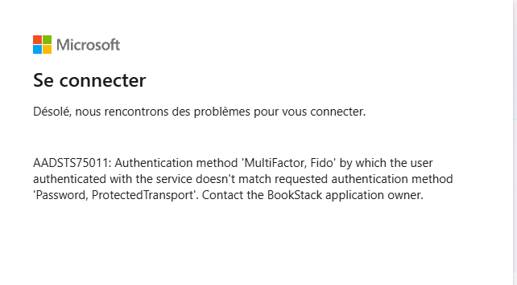

Il s'agit de l'erreur `AADSTS75011` : la méthode d'authentification utilisée par l'utilisateur (`MultiFactor, Fido`) ne correspond pas à la méthode demandée par l'application (`Password, ProtectedTransport`).

Cela vient du paramètre `SAML2_IDP_AUTHNCONTEXT`. Avec la valeur `true` (valeur par défaut), BookStack inclut dans sa requête d'authentification SAML un `AuthnContext` exact de type `PasswordProtectedTransport`, c'est-à-dire qu'il impose une authentification par mot de passe. Or Entra ID a authentifié l'utilisateur par une autre méthode (MFA / FIDO), et refuse donc la connexion.

La solution est de mettre `SAML2_IDP_AUTHNCONTEXT=false` dans le fichier `.env` : BookStack n'envoie alors aucune exigence de méthode d'authentification à Entra ID, qui accepte celle que l'utilisateur a utilisée.
